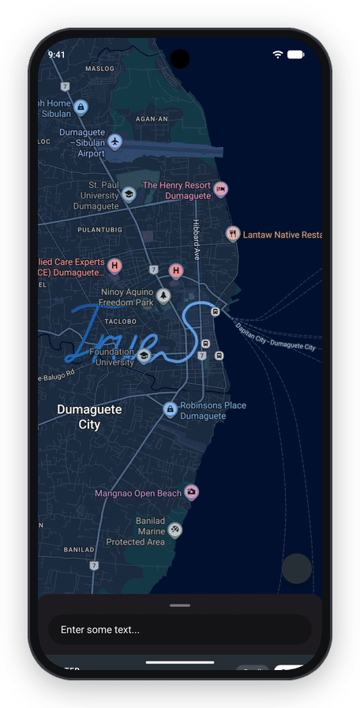

# React Native TrueSheet

[](https://github.com/lodev09/react-native-true-sheet/actions/workflows/checks.yml)
[](https://www.npmjs.com/package/@lodev09/react-native-true-sheet)

The true native bottom sheet experience for your React Native Apps. 💩

<picture>
  <source media="(prefers-color-scheme: dark)" srcset="docs/public/img/previews/preview-ios-dark.gif" />
  
</picture>
<picture>
  <source media="(prefers-color-scheme: dark)" srcset="docs/public/img/previews/preview-android-dark.gif" />
  
</picture>
<picture>
  <source media="(prefers-color-scheme: dark)" srcset="docs/public/img/previews/preview-web-dark.gif" />
  
</picture>

## Features

* ⚡ **Powered by Fabric** - Built on React Native's new architecture for maximum performance
* 🚀 **Fully Native** - Implemented in the native realm, zero JS hacks
* ♿ **Accessible** - Native accessibility and screen reader support out of the box
* 🔄 **Flexible API** - Use [imperative methods](https://sheet.lodev09.com/reference/methods#component-methods) or [lifecycle events](https://sheet.lodev09.com/reference/events)
* ⌨️ **Keyboard Handling** - Built-in [keyboard handling](https://sheet.lodev09.com/guides/keyboard) with automatic adjustment
* 📐 **Side Sheets** - Native [side sheet](https://sheet.lodev09.com/guides/side-sheets) support for iPad and Android tablets
* 🎨 **Backgrounds** - Colors, blur, glass tints, and [per-detent backgrounds](https://sheet.lodev09.com/guides/backgrounds) on all platforms
* 🍞 **Overlays** - Render toasts and dialogs [above your sheets](https://sheet.lodev09.com/guides/overlays) with `TrueSheetOverlay`
* 📱 **Foldables** - [Rest the sheet on the hinge](https://sheet.lodev09.com/guides/foldables) of a half-folded iPhone (iOS 27.1+)
* 🪟 **Liquid Glass** - [iOS 26+ Liquid Glass](https://sheet.lodev09.com/guides/liquid-glass) support out of the box, featured in [Expo Blog](https://expo.dev/blog/how-to-create-apple-maps-style-liquid-glass-sheets)
* 🐎 **Reanimated** - First-class support for [react-native-reanimated](https://sheet.lodev09.com/guides/reanimated)
* 🧭 **React Navigation & Expo Router** - Built-in [sheet navigator](https://sheet.lodev09.com/guides/navigation) and [Expo Router `Sheet` layout](https://sheet.lodev09.com/guides/navigation#expo-router)
* 🌐 **Web Support** - Full [web support](https://sheet.lodev09.com/guides/web) out of the box

## 🎉 True Sheet 4.0 is here!

> [!TIP]
> v4 rewrites the layout engine — the sheet now lays out synchronously per detent and tracks its visible height in realtime while dragging. Read the [announcement](https://sheet.lodev09.com/blog/release-4-0) and see the [Migration Guide](https://sheet.lodev09.com/migration) to upgrade.

## Installation

### Prerequisites

- React Native 0.82+
- New Architecture enabled
- Xcode 26.1+

### Compatibility

| TrueSheet  | React Native | Expo SDK |
|------------|--------------|----------|
| 4.0+       | 0.82+        | 55+      |
| 3.7 - 3.11 | 0.81-0.86    | 54-57    |
| 3.6        | 0.80         | 52-53    |

### Expo

```sh
npx expo install @lodev09/react-native-true-sheet
```

### Bare React Native

```sh
yarn add @lodev09/react-native-true-sheet
cd ios && pod install
```

## Documentation

- [Example](example)
- [Configuration](https://sheet.lodev09.com/reference/configuration)
- [Lifecycle Events](https://sheet.lodev09.com/reference/events)
- [React Navigation & Expo Router](https://sheet.lodev09.com/guides/navigation)
- [Troubleshooting](https://sheet.lodev09.com/troubleshooting)
- [Testing with Jest](https://sheet.lodev09.com/guides/jest)
- [Migrating to v4](https://sheet.lodev09.com/migration)

## Usage

```tsx
import { TrueSheet } from "@lodev09/react-native-true-sheet"

export const App = () => {
  const sheet = useRef<TrueSheet>(null)

  // Present the sheet ✅
  const present = async () => {
    await sheet.current?.present()
    console.log('horray! sheet has been presented 💩')
  }

  // Dismiss the sheet ✅
  const dismiss = async () => {
    await sheet.current?.dismiss()
    console.log('Bye bye 👋')
  }

  return (
    <View>
      <Button onPress={present} title="Present" />
      <TrueSheet
        ref={sheet}
        detents={['auto', 1]}
      >
        <Button onPress={dismiss} title="Dismiss" />
      </TrueSheet>
    </View>
  )
}
```

## AI Skills

Skills are reusable AI capabilities that give your AI coding agent knowledge about TrueSheet. With the right skill loaded, your agent can pick the right patterns, avoid common mistakes, and generate correct code without you having to explain the library every time.

```sh
npx skills add lodev09/react-native-true-sheet
```

This will install the **TrueSheet Usage** skill into your project.

## That map is awesome!

Yes it is! Checkout [`@lugg/maps`](https://github.com/lugg/maps), a universal maps library for React Native that I'm developing at [Lugg](https://lugg.com).

## Contributing

See the [contributing guide](CONTRIBUTING.md) to learn how to contribute to the repository and the development workflow.

## License

[MIT](LICENSE)

---

Made with ❤️ by [@lodev09](http://linkedin.com/in/lodev09/)
